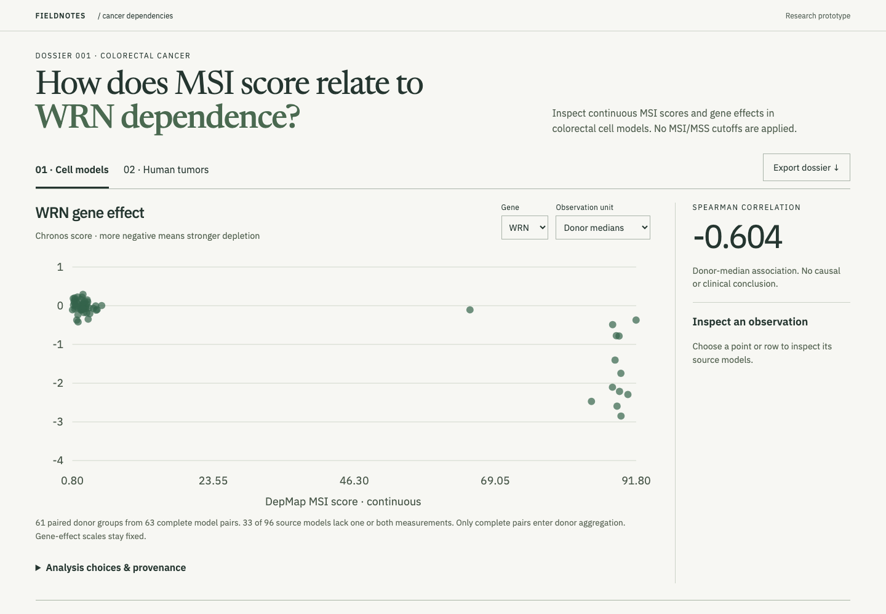

# Fieldnotes



[Open demo](https://fieldnotes.jordanmatthew.me)

Does the observed relationship between WRN dependency and MSI score change when related colorectal cell models are counted once per source donor?

A research workbench for inspecting a pinned DepMap cohort, comparing model and donor views, tracing individual observations and reproducing an exported analysis. A separate TCGA layer adds tumor expression context without joining individuals across datasets.

## Technical decisions

- Pair complete measurements before donor aggregation.
- Check source identities and calculations in both Python and TypeScript.
- Report uncertainty and leave-one-donor-out influence with explicit assumptions.
- Keep experimental dependency and tumor expression in separate evidence layers.

## Observed result

The captured cohort contains 63 complete WRN/MSI model pairs from 61 donors. Spearman correlation is approximately −0.603 by model and −0.604 by donor. This stability does not resolve confounding or establish treatment benefit.

## Reproduction and status

The combined local release package includes `fieldnotes-site/` and `cancer-dependency-workbench/`, with a root verification command and a source/file-hash manifest. It preserves the source identities of the two projects.

Node 22+, from the package root:

```sh
cd fieldnotes-site
npm ci
npx playwright install chromium
npm test
npm run preview
```

Python 3.12, from the package root:

```sh
python3.12 -m venv .venv
.venv/bin/python -m pip install -r cancer-dependency-workbench/requirements.txt
.venv/bin/python verify.py
```

Full source reproduction additionally requires `fetch_sources.py` (approximately 430 MB download) followed by `verify.py --reproduce`. The ordinary verification command does not download or reproduce all raw sources. See the release setup guide for those commands and source terms. Direct Python dependencies are pinned; transitive dependencies are not fully locked.

Read `cancer-dependency-workbench/research/CASE_STUDY.md` for methods and interpretation. No public repository or production performance claim is made.

Public research prototype. Physical-phone testing, full screen-reader review, independent researcher feedback and final design acceptance remain open. Preserve source-specific attribution and redistribution boundaries. GitHub source publication remains pending account verification. Saved dossiers can be verified and reopened against the displayed snapshot.