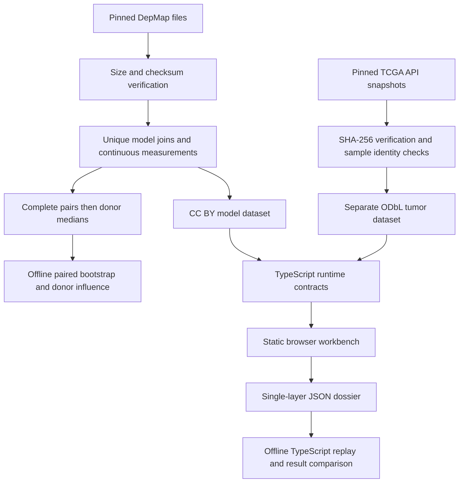

# Fieldnotes architecture

Status: implemented system as of September 29, 2026. Uncertainty is available in WRN donor mode with a separate replayable download.

## Purpose and boundary

A researcher can inspect a fixed colorectal cell-model cohort, compare five prespecified genes, switch from models to source-donor medians, inspect missing measurements and export a replayable analysis. A separate tumor-expression view adds context. There is no patient-level join, predictive model or treatment recommendation.

## Data flow

The bootstrap artifact is computed in Python, shown only in WRN donor mode, and downloaded as a separate source-bound uncertainty dossier. Browser contracts verify source identity and influence calculations. The Python replay reruns the bootstrap; ordinary observation dossier replay remains unchanged.

## Responsibilities

| Component | Responsibility | Failure behavior |
| --- | --- | --- |
| `scripts/fetch_sources.py` | Pinned downloads, cached-file checks, staged replacement | Reject invalid bytes; preserve existing file |
| `scripts/reproduce.py` | Verify pinned inputs before rebuilding evidence and uncertainty | Stop at failed command or snapshot check |
| `scripts/build_continuous_dataset.py` | One-to-one joins, exact lineage, fixed genes | Reject duplicate or missing model identities |
| `scripts/continuous_sensitivity.py` | Select complete pairs before donor medians | Reject missing donor identity and nonfinite paired values |
| `scripts/continuous_uncertainty.py` | Seeded paired donor bootstrap; leave-one-donor-out analysis | Report unavailable for degenerate data; never discard undefined replicates silently |
| `scripts/analyze_tcga.py`, `scripts/build_tumor_dataset.py` | Sample/patient identity, coverage, expression transformation | Reject inconsistent snapshots or measurements |
| Site `src/schema.ts`, `src/contract.ts` | Parse unknown JSON; verify identities, derived values and coverage | Do not render or export rejected evidence |
| Site `src/dossier.ts` | Gene/unit configuration, observations and recomputable analysis | Reject unknown configuration and invalid selection |
| Site `src/continuous.ts`, `src/tumor.ts` | Separate views, source inspection, URL state and downloads | Keep independent valid evidence usable when the other layer fails |
| Site `scripts/replay.mjs` | Recompute dossier analysis and compare | Reject altered results |

Paths prefixed “Site” refer to `../fieldnotes-site`; other paths belong to this research directory.

## Why static

The current workload is two modest, fixed public-data derivatives and local descriptive calculations. Static hosting avoids an unnecessary server and keeps the evidence snapshot stable. No login-backed research database, secret-bearing API proxy or live scientific API is needed for these interactions. Sites provides owner-only access separately from the static application.

This decision is supported by measured local interaction and loading results in `../fieldnotes-site/PERFORMANCE.md`. Those measurements are not hosted or physical-device benchmarks. If future data or computation materially changes the workload, remeasure before changing architecture.

## Scientific contracts

- Missing measurements remain null; no zero imputation.
- Donor medians use models with both measurements present. Complementary missing measurements cannot manufacture a pair.
- A source donor may have several models. The median pair need not correspond to one measured model.
- Spearman correlation needs at least three nonconstant pairs in both Python and TypeScript.
- The bootstrap requires at least four donors and belongs only to the WRN donor-median estimand.
- TCGA expression is transformed as log2(RSEM + 1). It is not a gene-dependency measurement.
- Comparator genes do not receive significance tests or target rankings.

## Provenance and licensing

Pinned identifiers and checksums support byte consistency; they do not independently authenticate the upstream publisher. DepMap and TCGA derivatives retain separate attribution and exports. Historical manuscript category labels with unresolved redistribution terms remain outside hosted output. A downloaded dossier contains one evidence layer, its configuration and the analysis needed for replay.

## UX and design contract

The chart, selected observation and source details must tell one coherent story. Selection has a direct label and axis guides; related dots recede. A table offers a non-chart path through the evidence. Phone controls use available width deliberately; keyboard and dialog focus behavior are tested.

These implemented details do not establish final design quality. The remaining visual review must address type hierarchy, composition, chart/detail continuity, touch use and real data at narrow widths. Technical correctness, usefulness and beautiful design remain equal completion gates.

## Verified limits and unfinished work

Twenty-three Python tests currently pass. The Site has separate corruption, replay, browser failure/recovery and scoped automated accessibility checks. Full screen-reader and physical-phone validation, independent researcher feedback, public GitHub packaging and final portfolio review are unfinished. No adoption, clinical value or independent replication is claimed.

Next: finish the technical case study and a full design review. The uncertainty download has an explicit fieldnotes-uncertainty-v1 format; its Python replay requires the research repository and pinned environment. It is independent of version-1 observation exports.
